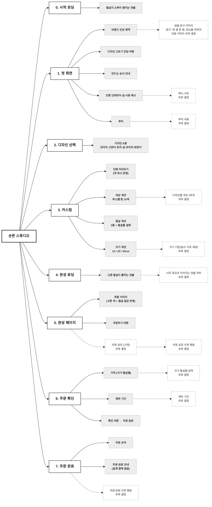

# 손뜬 스튜디오 — 사이트 맵

> 근거 문서: [01-site-purpose.md](01-site-purpose.md), [02-site-structure.md](02-site-structure.md) · Figma 와이어프레임 수정본 기준으로 갱신
> 표기: **[가정]** = 01 문서의 '기획을 위한 가정' 항목 / **추후 결정** = 아직 정하지 않은 항목

## Figma

| 프레임 이름 | 페이지 | 링크 |
|---|---|---|
| 손뜬 스튜디오 사이트 맵 | 사이트맵 | [Figma에서 열기](https://www.figma.com/design/glKnPfdLDyPU6fjBcxhi4d/%EC%86%90%EB%9C%AC-%EC%8A%A4%ED%8A%9C%EB%94%94%EC%98%A4?node-id=4-2) |

### Figma 사이트맵 프레임에 아직 반영되지 않은 내용

이 문서는 와이어프레임 수정본을 기준으로 정리했습니다. Figma의 사이트맵 프레임은 아래 항목이 이전 상태로 남아 있어 수정이 필요합니다.

| 항목 | Figma 사이트맵 프레임 (현재) | 이 문서 (와이어프레임 기준) |
|---|---|---|
| 7번 페이지 | 7. 결제 화면 / 결제창 화면 (실제 결제 없음) | 7. 주문 완료 / 주문 요약·완료 안내 (실제 결제 없음) |
| 7번 하위 미정 항목 | 결제 이후 화면 — 추후 결정 | 주문 완료 이후 행동 — 추후 결정 |
| 6번 확인 버튼 | 확인 버튼 → 결제 화면 | 확인 버튼 → 주문 완료 |
| 1번 첫 화면 섹션 | 브랜드 인상 영역, 디자인 고르기 진입 버튼 | + 만드는 순서 안내, 인형 인테리어·실 사용 예시, 푸터 |

## 범례

| 구분 | 표현 |
|---|---|
| 페이지 | 흰색 실선 박스 |
| 내부 섹션 | 연회색 작은 박스 |
| 미정 항목 ([가정] 포함) | 점선 박스 + '추후 결정' 표기 |

## 1. 가로 계층도

## 2. 텍스트 계층

- **손뜬 스튜디오**
  - **0. 시작 로딩**
    - 털실이 소복이 쌓이는 연출
  - **1. 첫 화면**
    - 브랜드 인상 영역
      - ┄ 담을 문구·이미지 — 문구 "한 땀 한 땀, 당신을 위하여" / 대표 이미지 *추후 결정*
    - 디자인 고르기 진입 버튼
    - 만드는 순서 안내
    - 인형 인테리어·실 사용 예시
      - ┄ 예시 사진 — *추후 결정*
    - 푸터
      - ┄ 푸터 내용 — *추후 결정*
  - **2. 디자인 선택**
    - 디자인 6종: 강아지 / 고양이 / 토끼 / 곰 / 코끼리 / 호랑이
  - **3. 커스텀** (색상·털실·크기를 한 페이지에서 선택)
    - 인형 미리보기 (색 즉시 반영)
    - 색상 섹션: 빨강·분홍·주황·노랑·초록·파랑·남색·검정·회색·흰색 (약간 파스텔 톤)
      - ┄ 디자인별 색상 3부위 — *추후 결정* (호랑이 줄무늬, 코끼리 귀·코 처리 포함)
    - 털실 섹션: 부슬부슬한 털실 / 벨벳형 부드러운 털실 / 두툼한 털실 + 털실별 설명
    - 크기 섹션: 10cm / 20cm / 30cm
      - ┄ 크기 기준(높이·가로·세로) — *추후 결정*
  - **4. 완성 로딩**
    - 고른 털실이 뽑히는 연출
      - ┄ 시작 로딩과 이어지는 연출 여부 — *추후 결정*
  - **5. 완성 페이지**
    - 최종 이미지 (고른 색 + 털실 질감 반영)
    - 주문하기 버튼
    - ┄ 저장·공유 **[가정]** — *추후 결정*
      - ┄ 저장·공유 이후 행동 — *추후 결정*
  - **6. 주문 확인**
    - 가격 (크기·털실에 따라 다름)
      - ┄ 크기·털실별 금액 — *추후 결정*
    - 제작 기간
      - ┄ 제작 기간 — *추후 결정*
    - 확인 버튼 → 주문 완료
  - **7. 주문 완료**
    - 주문 요약
    - 주문 완료 안내 (실제 결제 없음)
    - ┄ 주문 완료 이후 행동 — *추후 결정*

> ┄ = 점선(미정 항목)

## 3. 페이지 이동 순서

0. 시작 로딩 → 1. 첫 화면 → 2. 디자인 선택 → 3. 커스텀 → 4. 완성 로딩 → 5. 완성 페이지 → 6. 주문 확인 → 7. 주문 완료
